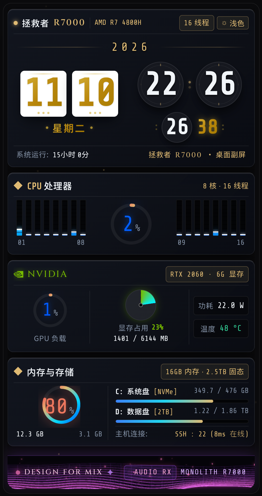

# MixMonolith · 小米 MIX 桌面极客副屏 (Design For Mix)

[](https://android.com)
[](https://mi.com)
[](https://lenovo.com)
[]()
[]()

将初代全面屏神机 **小米 MIX 1**（1080×2040 全面屏，460 DPI）改造为专为 **联想拯救者（Legion R7000，AMD R7 4800H + NVIDIA RTX 2060）** 定制的桌面硬核极客副屏 HUD 监控系统。

> 💎 **Design For Mix**：宿主机**零常驻后台、零安装监控服务端（Zero Daemon）**，仅通过局域网 SSH 密钥鉴权与毫秒级 PowerShell 探针驱动，单屏严丝合缝无滚动，融合科技感拟态翻页时钟、16核阵列、实体显存饼图与麦克风声波响应 3D 网格。

---

## 📸 实机运行效果 (Xiaomi MIX 1 Real-Device Capture)

<div align="center">
  
  <p><em>小米 MIX 1 实机运行截图 (1080×2040 严密单屏 HUD)</em></p>
</div>

---

## ✨ 核心特性

- **🛡️ 宿主机零常驻 (Zero Daemon on Host)**
  无需在 Windows / Linux 宿主机上安装任何 Python 脚本、AIDA64 服务端或常驻第三方监控软件。手机端通过 JSch SSH 原生连接 Windows 内置 OpenSSH Server，定期执行原生 PowerShell 命令采集系统硬件指标。
- **⏱️ 真实宿主机系统运行时间 (Host Uptime)**
  直读 Windows 内核 `Win32_OperatingSystem.LastBootUpTime`，显示拯救者宿主机真正的开机运行时长（而非 App 启动时间），前端自动补偿插值计数。
- **🕰️ 机械拟态翻页时钟与高频毫秒秒表 (Flip Clock & Chronograph)**
  3D 透视机械翻页日历（年/月/日/星期/时/分）搭配 60 帧高频秒表与毫秒计数，支持中西字体分流排版（MiSans + Share Tech Mono）。
- **⚡ 16 线程 CPU 分布矩阵 (AMD Ryzen 7 4800H)**
  8 核 16 线程对称梯形独立动态柱状负载指示器，结合整体利用率流光圆环。
- **🟢 NVIDIA 黄金比例三等分布局 (RTX 2060)**
  - **左 1/3**：GPU 核心利用率环形动态仪表；
  - **中 1/3**：**实体填充式**显存占用锥形渐变饼图（Conic Gradient），实时显示已用显存与总显存容量（MB）；
  - **右 1/3**：功耗（W）与温度（°C）紧凑胶囊，内部居中对齐、右侧微收纳。
- **💾 存储与内存监控**
  双通道 16GB 内存实时用量，双 NVMe 固态硬盘（C 盘系统盘 512GB + D 盘数据盘 2TB）进度条展示。
- **🌊 麦克风环境声波响应 3D 网格 (Reactive Cyberpunk Wave Mesh)**
  底部集成三维透视网格，通过 Web Audio API 采集环境声学振幅，使紫光网格峰峦起伏，并伴随悬浮微粒与专属金标「DESIGN FOR MIX」。
- **📐 极致单屏适配 (Zero Vertical Scrolling)**
  针对小米 MIX 1 独特的 17:9（1080×2040）陶瓷全面屏比例深度调优，所有模块严密嵌合，绝不产生纵向溢出滚动。

---

## 🛠️ 项目结构

```
.
├── MixMonolithBuild/
│   ├── AndroidManifest.xml        # Android 清单（开机全屏、常亮、网络权限）
│   ├── assets/
│   │   ├── index.html             # HUD 核心前端（单文件极简 Cyberpunk 引擎）
│   │   └── mix_rsa.example        # SSH 密钥模板（实际私钥请勿提交）
│   ├── res/                       # 应用图标与字符串资源
│   └── src/com/mix/monolith/
│       └── MainActivity.java      # 原生 Android 容器、JSch SSH 轮询后台与 JS Bridge
├── build_apk.py                   # 免 Android Studio / 免 Gradle 一键编译打包脚本
├── generate_mix_hud.py            # HUD 前端生成与调优脚本
├── jsch.jar                       # SSH2 Java 客户端库
├── android.jar                    # Android SDK 编译库
├── r8.jar                         # D8 / R8 Dexer 工具
├── aapt2.exe                      # Android 资源打包工具
├── debug.keystore                 # 调试签名证书
├── mix_rsa.example                # 根目录私钥配置示范
└── docs/
    └── screenshot.png             # 小米 MIX 实机演示截图
```

---

## 🚀 极速构建与部署 (One-Click Build)

本项目配备了**轻量化独立工具链**，无需安装耗资数十 GB 的 Android Studio 或 Gradle，只要本地具备 **Python 3** 和 **JDK 8 (Java)** 即可一键生成签名 APK 并推送到手机。

### 1. 配置 SSH 访问密钥
1. 在 Windows 宿主机上启用并配置 OpenSSH Server（`sshd`）。
2. 生成一对无密码短语的 RSA 密钥：
   ```powershell
   ssh-keygen -t rsa -b 2048 -f mix_rsa -N '""'
   ```
3. 将公钥内容追加到宿主机的 `C:\Users\<YourUser>\.ssh\authorized_keys`。
4. 将私钥文件命名为 `mix_rsa`，放置于 `MixMonolithBuild/assets/mix_rsa` 中（或配置在代码中）。
5. 在 `MainActivity.java` 中调整宿主机内网 IP（默认 `10.0.0.252`）与用户名。

### 2. 一键编译并安装到手机
确保手机开启 USB 调试并通过 ADB 连接：
```bash
python build_apk.py
```
脚本将自动完成：
1. `javac` 编译 Java 源码；
2. `r8 / D8` 生成 `classes.dex`；
3. `aapt2` 资源链接并打包 APK；
4. `jarsigner` 签名并自动执行 `adb install -r` 和启动应用。

---

## 🖥️ 宿主机探针原理 (Host Probe Query)

无需任何后台服务，手机端每隔 2 秒通过 SSH 在宿主机执行一条超低开销的 PowerShell 组合命令：

```powershell
$p = Get-CimInstance Win32_PerfFormattedData_PerfOS_Processor;
$total = ($p | ? Name -eq '_Total').PercentProcessorTime;
$cores = ($p | ? Name -ne '_Total' | sort { [int]$_.Name }).PercentProcessorTime -join ',';
$os = Get-CimInstance Win32_OperatingSystem;
$sec = [int]((Get-Date) - $os.LastBootUpTime).TotalSeconds;
$gpu = (nvidia-smi --query-gpu=utilization.gpu,memory.used,memory.total,temperature.gpu,power.draw --format=csv,noheader,nounits);
Write-Output ('{0}|{1}|{2}|{3}|{4}|{5}' -f $total, $cores, $os.FreePhysicalMemory, $os.TotalVisibleMemorySize, $gpu, $sec)
```

一次返回：`CPU总体 | 16核分负载 | 剩余内存 | 总内存 | GPU指标(利用率/显存/温度/功耗) | 真实开机秒数`。

---

## 📄 开源许可证

本项目基于 [MIT 许可证](LICENSE) 开源。
欢迎 Fork、Star 和贡献代码！
