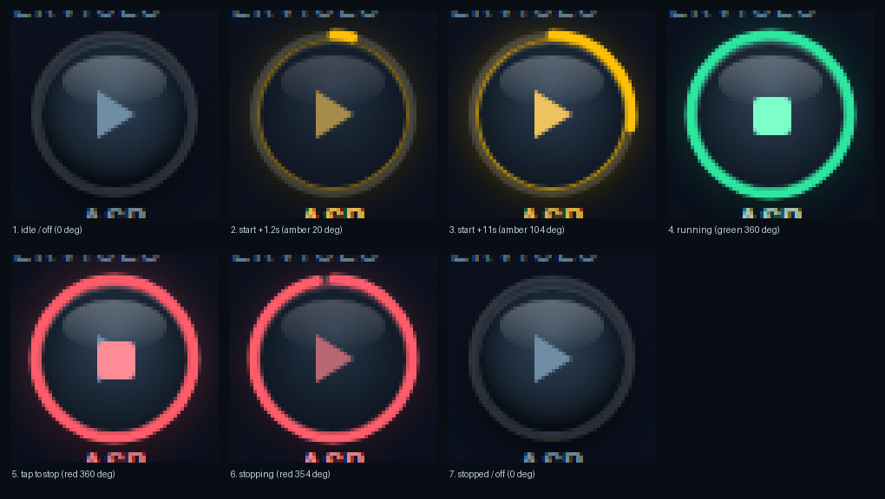

# 操作手册 · 从零到「TouchPad 显示 jd4090 服务器状态」

## A. 服务器（<SERVER_IP> / jd4090）

**已清理**：原先的 8080 HTTP 探针（`~/hpscope/server_probe.py` + `hpscope-probe.service`）已停止、
禁用并连同 `~/hpscope` 一起删除，8080 端口空闲。现在服务器侧唯一的改动就是
`~/.ssh/authorized_keys` 里那一行 `restrict … hpscope-touchpad-app`。

## A2. SSH 只读模式（APK 默认，服务端零安装）

App 用 JSch 直连 SSH，把 `assets/probe_remote.py` 通过 exec 通道送进 `python3 -` 执行，
服务器上**不写文件、不装包、不起守护进程**。

1. **无需配置**：APK 自带身份 `assets/hpscope_key`（RSA-3072），首次运行时复制到
   应用私有目录；服务器上已预授权（用你现有的 `~/.ssh/id_ed25519_204` 追加的），装完即连。
2. 服务器那行长这样（`restrict` = 禁端口转发/agent/X11/PTY，最小权限）：

```
restrict ecdsa-sha2-nistp256 AAAA... hpscope-touchpad-app
```

3. 想换密钥：设置 →「重置密钥」→「公钥」→ 复制 → 追加到 `~/.ssh/authorized_keys`。
4. 点「测试」，应显示 `OK 3xxx B {"ts":...}`。

排障要点：

- 服务器是 OpenSSH 9.6（Ubuntu 24.04），默认禁用 `ssh-rsa`（SHA-1），也别用 ed25519：
  **JSch 0.1.55 不支持 ed25519**。所以 App 固定用 ECDSA（主机密钥也协商 ECDSA）。
  你现有的 `id_ed25519_204` 只作为「引导授权」用，不进入 APK。
- 手工复现 App 的行为（用 APK 内的同一把密钥）：

```powershell
cd C:\docker\HPpad\tools\ssh_test
java -cp ".;..\vendor\jsch-0.2.20-android.jar" TestSsh "..\..\app\src\HpScope\assets\hpscope_key" "..\..\app\src\HpScope\assets\probe_remote.py"
```

- 真实 SSH 数据的预览：`powershell -File tools\make_ssh_preview.ps1`
  → `docs\dashboard_ssh_preview.html`（两次真实快照 + 2 s 重放，不依赖任何服务器进程）。
- 轮询耗时实测：握手 ~400 ms，单次采集 ~450 ms（含 0.35 s 进程采样窗口），回包约 3.7 KB。

### A2b. 服务启停（STORAGE / SENSORS 卡内的拟物圆盘）

5 个圆盘：STORAGE 卡里 `QWEN·HQ 9020`（HyperQwen 生产）、`QWEN·Q8 9022`（Qwen3.8-27B UD-Q8，新主口）；
SENSORS 卡里 `ASR 13560`、`TTS 13561`、`MINERU 9038`。`8090 / 9021 / 8000` 已废弃，页面不再管。

- 灰盘 ▶ = 未运行 → 点一下启动；绿盘 ■ = 运行中 → 点一下变红（确认），3 s 内再点一次才停止；红盘不会被 2 s 轮询抹掉。
- 圆盘外圈的**进度环**：灰环 = 已停止（0%）、绿环满圈 = 运行中、琥珀环按加载时间填充（端口监听后立刻补满变绿）、
  停止时红环从满圈收缩、确认态满圈红。环的状态每秒刷新 10 次，比只看颜色更容易确认「起没起/停没停」。
- 琥珀 = 命令已发出：启动等到端口监听、停止等到端口释放，90 s 只是兜底；失败弹出服务端原文（显存门限/端口占用/脚本退出码）。
- 三条服务盘下面是红色 `STOP ALL · GPU`：第一次点只进入确认态（文字变 `TAP AGAIN · STOP ALL`，3 s 内再点一次），
  执行中显示 `STOPPING…`；按端口停掉 **5 个服务**里所有在监听的实例（ASR/TTS/MINERU 先，9020/9022 最后），
  结果原文（如 `stopped: asr,tts`）在 APK 里是 Toast，本地 harness 里是页面底部浮层。
- 按下有轻触反馈（VIBRATE 权限），失败时 35/70/35 ms 双震。
- 实现与探针同路：按钮 → JS 桥 → SSH exec `python3 - <start|stop|stopall> <id>`（`assets/svc_ctl.py`，白名单 5 个 id）。
- 服务/模型/启动命令的权威表格在服务器 `~/README.md`（2026-11-15 03:30 版）。

### A2c. 2026-11-15 实测（同 APK 链路：SSH piped `python3 - <action> <id>`）

| 动作 | 结果 | 用时 |
|---|---|---|
| `stopall`（当时 8090 在跑，18.9 GB） | 监听实例全停，显存 → 471 MiB | 2 s |
| `start asr` → `stop asr` | 13560 监听 → 释放，pidfile 清理 | 30 s / 2 s |
| `start tts` → `stop tts` | 13561 监听 → 释放，pidfile 清理 | 42 s / 1 s |
| `start llm9020` → `stop llm9020` | `/health` 200（生产 vLLM），`--stop` 能清 pidfile | 32 s / 3 s |
| `start llm9022` | 待权重下完（当时 9.7 / 31.5 GB），脚本 `--start/--stop/--status` 已就绪 | — |

9022 现在是 llama.cpp（`serve_9022_qwen38.sh`，`--start/--stop/--status`），key 在 `~/qwen_service/qwen_9022.key`，
日志 `qwen_service/qwen_9022.log`，pid `~/run/llama_9022.pid`；权重三件（主 GGUF / mmproj / 可选 MTP）没下全时不能起。

### A2d. 真机联调（浏览器里点按钮，真的启停服务）

`docs/dashboard_ssh_preview.html` 的圆盘是死的（页面没有 `HpScopeBridge`）。想在电脑上看真实启停和进度环动画：

```powershell
python tools\preview_live_harness.py        # 打开 http://127.0.0.1:8099/
```

它只监听 `127.0.0.1`，用与 APK 相同的两条链路（`probe_remote.py` / `svc_ctl.py`）经 SSH 连 jd4090，
点圆盘会真的启动/停止服务，页面的琥珀 → 绿、红 → 灰都是真实状态机。

实测（2026-11-15，点 ASR）：1.2 s 琥珀环 20°、11 s 104°、30.7 s 端口监听环满分绿；
点一下变满圈红（确认），第二次点击后 0.1 s 红环 354°，约 0.6 s 后端口释放、环归零。
全程 7 帧截图：`docs/preview_ring_states_real.png`。



## B. Windows 端构建 APK ——已完成

```powershell
cd C:\docker\HPpad
powershell -ExecutionPolicy Bypass -File app\build.ps1
# BUILD OK -> C:\docker\HPpad\dist\HpScope.apk (241 KB)
```

## C. TouchPad 端安装 —— 待接线（需要你把平板用 USB 插上）

```powershell
cd C:\docker\HPpad\tools\platform-tools
.\adb.exe kill-server; .\adb.exe start-server
.\adb.exe devices -l          # 期望看到序列号 + model: ?
```

**没看到设备？**
1. 平板端：设置 → 开发者选项 → 打开「USB 调试」（Android 4.0：系统设置 → 关于平板 → 连点「版本号」7 次开发者选项，CM9 默认可能已开）。
2. 数据线要是**数据线**不是充电线；TouchPad 是老 micro-USB。
3. Windows 驱动：设备管理器里若显示未知设备/`Palm, Inc`，右键 → 更新驱动 →
   「浏览我的计算机」→ `C:\docker\HPpad\tools\platform-tools\usb_driver`（或 Google USB Driver；
   platform-tools 新版不含驱动，可用 `winget install --id Google.USBDriver`）。
4. 有些 TouchPad Android ROM 的 adb 端口被改过，可试 `.\adb.exe connect 192.168.x.x:5555`（平板 Wi-Fi 同网段，先 `adb shell ip route` 拿 IP）。

**装应用：**

```powershell
cd C:\docker\HPpad
powershell -ExecutionPolicy Bypass -File app\build.ps1 -Install
# 或手动：
tools\platform-tools\adb.exe install -r dist\HpScope.apk
tools\platform-tools\adb.exe shell am start -n com.hpscope.mon/.MainActivity
```

**使用：**
- 默认 SSH 目标 `jd4090@<SERVER_IP>:22`，2 s 刷新；横屏全屏、屏幕常亮。
- 改目标：按 **菜单键**（或长按屏幕 1.2 s）→ 改 主机/端口/用户 → 确定；「测试」按钮直接验证 SSH 连通性。
- 设为常驻监控屏：设置 → 应用 → HpScope → 「清除默认启动器」后按 Home 选它并勾选默认。

## D. 不重刷 ROM 的备选安装方式（adb 不可用时）

平板装在 Android 的 SD/内部存储里，直接把 APK 拷进去用文件管理器安装（需开「未知来源」）：

```powershell
tools\platform-tools\adb.exe push dist\HpScope.apk /sdcard/Download/
```

或进 CWM/TWRP recovery，`adb sideload` / 手动 push 到 `/sdcard` 再装。

---

## 附录 · 本次实测数据（证明链路可用）

Windows（JSch 桌面客户端，与 APK 同一套代码）→ `ssh jd4090 python3 -` 返回的原始计数（节选）：

```json
{
  "ts": 1794501966.72, "ts2": 1794501967.07,
  "host": "jd4090", "os": "Linux 6.11.0-17-generic",
  "distro": "Ubuntu 24.04.2 LTS", "arch": "x86_64",
  "cpu_model": "Intel(R) Core(TM) Ultra 9 285K", "cpu_cores": 24,
  "cpu":  [485950639, 483217571],          // [total jiffies, idle jiffies]
  "cpu2": [485951607, 483218530],          // 0.35 s 后再采一次 -> 首帧即可出百分比
  "cores": [[20029608, 19520469], "… 24 组"],
  "mem": {"total_kb": 197481936, "avail_kb": 187744256,
          "swap_total_kb": 8388604, "swap_free_kb": 8388604},
  "disks": [ {"mount": "/", "total_gb": 1829.7, "free_gb": 1093.0}, "… 4 项" ],
  "net": [ {"name": "enp130s0", "rx": 123456789, "tx": 9876543}, "… 7 个网卡" ],
  "load": {"1": 0.31, "5": 0.41, "15": 0.29},
  "gpu": {"name": "NVIDIA GeForce RTX 4090 D", "util": 0.0,
          "mem_used_mb": 418, "mem_total_mb": 49140, "fan_pct": 30.0,
          "temp": 31.0, "power_w": 13.09},
  "temp": {"cpu_c": 34.0, "zones": ["… 18 个传感器"], "fans": []},
  "top": [ {"pid": 8951, "name": "TeamViewer_Desk", "cpu": 2.9, "mem_gb": 0.25}, "…" ],
  "uptime_sec": 202788
}
```

百分比（CPU / 每核 / 网络速率）由 App 端用前后两帧差值计算，服务器只吐累积计数。

GPU 风扇：`gpu.fan_pct` 来自 `nvidia-smi --query-gpu=fan.speed`（百分比；卡不暴露风扇时为 `null`，
页面回退到 hwmon 的 `fanX_input` rpm，nvidia hwmon 待机 0 转速也会保留）。

APK 自检：

```
package: name='com.hpscope.mon' versionCode='1' versionName='1.0'
sdkVersion:'15'  targetSdkVersion:'15'
launchable-activity: name='com.hpscope.mon.MainActivity'  label='HpScope'
Signer #1 certificate DN: CN=Android Debug, O=Android, C=US   (v1+v2 已签名)
zip 内容: AndroidManifest.xml / res/drawable/ic.png / resources.arsc
          assets/index.html / assets/svc_ctl.py / assets/probe_remote.py / assets/hpscope_key / classes.dex
```

> 采集体积：脚本 10.5 KB（每次 exec 上行）、回包约 3.6 KB；握手 ~400 ms，单次采集 ~450 ms。
